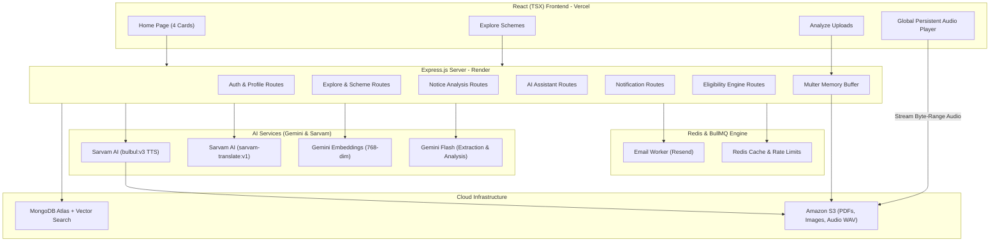

# 🏛️ Lok Setu (NagrikMitra AI) — Complete JavaScript Execution Plan
### Forge GenAI Buildathon · Theme 1: Civic Pulse, Digital Governance & Public Information
### Spectrum 1: Multilingual Policy, Rights & Scheme Explainer
**2-Person Team · 48-Hour Build · 100% JavaScript (MERN Stack + Gemini & Sarvam AI)**

---

## 📋 Table of Contents
1. [Executive Summary & System Vision](#1-executive-summary--system-vision)
2. [Strict Non-Negotiable Hackathon Rules](#2-strict-non-negotiable-hackathon-rules)
3. [Design System & 8 Supported Languages](#3-design-system--8-supported-languages)
4. [Current Codebase Audit (What is Already Built)](#4-current-codebase-audit-what-is-already-built)
5. [The 4 Core Home Page Cards & Workflows](#5-the-4-core-home-page-cards--workflows)
6. [System Architecture & Data Flow](#6-system-architecture--data-flow)
7. [Database Schemas & Data Models Reference](#7-database-schemas--data-models-reference)
8. [Person 1 Commit Plan (Backend, RAG, AI Agents & Infra)](#8-person-1-commit-plan-backend--ai)
9. [Person 2 Commit Plan (Frontend, Data Connectors & Voice)](#9-person-2-commit-plan-frontend--ui)
10. [Joint Commits (Integration, E2E Testing, Release)](#10-joint-commits-integration--release)
11. [48-Hour Hourly Schedule](#11-48-hour-hourly-schedule)
12. [Final Definition of Done & Release Checklist](#12-final-definition-of-done)
13. [Recommended Next Feature & Implementation Scope](#13-recommended-next-feature--implementation-scope)

---

## 1. Executive Summary & System Vision

### Problem
Government notifications, welfare policy drafts, and municipal by-laws are inaccessible to ordinary citizens and small businesses. They are written in dense bureaucratic legalese, buried in multi-page scanned gazettes, and lack actionable clarity regarding who qualifies, what rights exist, what penalties apply, and what immediate steps must be taken.

### Solution
**Lok Setu (NagrikMitra AI)** is an intelligent, source-grounded civic platform that ingests official government documents (and user-uploaded notices/challans), retrieves clause-level legal evidence, and converts them into **plain, regional-language voice explainers (60–90s audio pods via Sarvam AI)** alongside structured breakdowns:
* **Exact Rights & Protections:** What authorities cannot do, procedural entitlements.
* **Eligibility Checklist:** Income thresholds, caste/category, age limits, required documents.
* **Real-World Impacts:** Citizen perspective vs. Small Business / MSME perspective (fines, compliance, subsidies).
* **Actionable Roadmap:** Where to apply, required documents, deadline countdowns.

---

## 2. Strict Non-Negotiable Hackathon Rules

> [!CAUTION]
> Violating any of these rules will result in disqualification or heavy score deductions during hackathon judging.

1. **Zero Dummy/Seed Data in Runtime Code:** Never create hardcoded fake schemes, mock circulars, or placeholder government cards. All data must originate from **real official government connectors** or **real citizen document uploads**.
2. **Honest Empty States:** If the database has no policies published in the last 7 days, render an honest empty state: *"No new government policies or notifications published this week."*
3. **Mandatory Citation Grounding:** Every single AI claim must cite the exact Section/Clause/Page of the source document or output: *"This document does not clearly specify this information."*
4. **"Stated in Source" vs "AI Interpretation":** The UI must visually distinguish direct factual quotations from AI reasoning/simplification using distinct badges.
5. **Mandatory Eligibility Disclaimer:** Always display: *"You may be eligible. This is a preliminary assessment and does not constitute an official government guarantee."*
6. **No API Keys in Frontend:** All Gemini API keys, Sarvam API keys, AWS credentials, and Redis/Resend secrets remain strictly in backend environment variables.
7. **Document Ownership & Privacy:** User-uploaded notices and personal demographic profiles must enforce strict ownership guards.

---

## 3. Design System & 8 Supported Languages

### A. Contemporary Editorial Indian Palette ("Neel & Vermilion")
* **Paper (Background):** `#F2EFE6` (Warm, non-glare editorial canvas)
* **Neel (Primary Navy):** `#263C59` (Authority, typography, navigation)
* **Vermilion (Primary Accent):** `#C84C32` (Action buttons, badges, notifications)
* **Sage (Subtle Green):** `#D7D9C5` (Eligibility satisfied, active status, chips)
* **Mustard (Highlight Gold):** `#E4B65A` (Deadlines, warnings, audio indicators)
* **White (Card Surface):** `#FFFFFF` (Clean, high-contrast readable cards)

*Rule:* No generic purple/blue AI gradients, no neon glow, and no heavy glassmorphism.

### B. The 8 Supported Languages (Strict)
All multi-lingual generation, i18n UI strings, and Sarvam voice synthesis support these 8 languages:
1. `en` (`en-IN`) — English
2. `hi` (`hi-IN`) — हिन्दी (Hindi)
3. `gu` (`gu-IN`) — ગુજરાતી (Gujarati)
4. `mr` (`mr-IN`) — मराठी (Marathi)
5. `kn` (`kn-IN`) — ಕನ್ನಡ (Kannada)
6. `ta` (`ta-IN`) — தமிழ் (Tamil)
7. `te` (`te-IN`) — తెలుగు (Telugu)
8. `bn` (`bn-IN`) — বাংলা (Bengali)

> [!NOTE]
> **Multilingual Voice & Translation Engine Reconciliation:**
> Language conversion and speech synthesis are powered by **Sarvam AI** (`sarvam-translate:v1` and `bulbul:v3`), replacing earlier references to Gemini TTS. Sarvam models map application language codes to BCP-47 tags (`en` ➔ `en-IN`, `hi` ➔ `hi-IN`, etc.). Google Gemini remains the selected provider for text extraction, embeddings (`gemini-embedding-001`), grounded analysis, and conversational RAG.

---

## 4. Current Codebase Audit (What is Already Built)

The project is structured with pure JavaScript ES modules in `backend/` and TypeScript/Vite in `frontend/`. Both workspaces build and pass 100% of their test suites (124 backend test assertions and 42 frontend TAP tests).

### Completed Infrastructure & Services
* ✅ **Dependencies Configured:** `express@5`, `mongoose@9`, `bullmq@5`, `ioredis@5`, `@aws-sdk/client-s3`, `@aws-sdk/s3-request-presigner`, `@google/genai`, `resend`, `bcrypt`, `jsonwebtoken`, `multer`, `helmet`, `cors`, `compression`, `express-rate-limit`, `rate-limit-redis`.
* ✅ **Security & Middlewares:**
  * [`src/middlewares/error.middleware.js`](backend/src/middlewares/error.middleware.js) — Centralized error handler using `ApiError`.
  * [`src/middlewares/auth.middleware.js`](backend/src/middlewares/auth.middleware.js) — JWT authentication (`verifyJWT`) and role validation (`verifyRole`).
  * [`src/middlewares/rateLimiter.middleware.js`](backend/src/middlewares/rateLimiter.middleware.js) — Redis-backed `apiRateLimiter` and `authRateLimiter`.
  * [`src/middlewares/multer.middleware.js`](backend/src/middlewares/multer.middleware.js) — Memory storage buffer uploader (PDF, DOCX, JPG, PNG, WEBP up to 10MB).
* ✅ **AI & Retrieval Engine:**
  * [`src/services/chunking.service.js`](backend/src/services/chunking.service.js) — Clause-aware legal chunker preserving section headings, offsets, and content hashes.
  * [`src/services/embedding.service.js`](backend/src/services/embedding.service.js) — Gemini 768-dim embeddings with retry backoff and batching.
  * [`src/services/indexing.service.js`](backend/src/services/indexing.service.js) — MongoDB Atlas Vector index orchestration and chunk persistence.
  * [`src/services/retrieval.service.js`](backend/src/services/retrieval.service.js) — Hybrid RAG combining Atlas `$vectorSearch` and keyword text search with Reciprocal Rank Fusion (RRF).
  * [`src/services/civicAnalysis.service.js`](backend/src/services/civicAnalysis.service.js) — Grounded multilingual analysis with citation enforcement and missing-information safeguarding.
  * [`src/services/noticeAnalysis.service.js`](backend/src/services/noticeAnalysis.service.js) — Citizen notice structured rights, penalties, and deadline extraction.
  * [`src/services/sarvam.service.js`](backend/src/services/sarvam.service.js) — Sarvam `sarvam-translate:v1` translation, `bulbul:v3` TTS synthesis, dynamic WAV subchunk parser (`parseWavInfo`), multi-chunk concatenation, and timer cleanup.
* ✅ **Asynchronous Queue & Storage:**
  * [`src/queues/email.queue.js`](backend/src/queues/email.queue.js) & [`src/workers/email.worker.js`](backend/src/workers/email.worker.js) — BullMQ worker for OTP and alert emails.
  * [`src/utils/s3Uploader.js`](backend/src/utils/s3Uploader.js) — S3 upload for notices and audio WAV with presigned URL signing.
* ✅ **Mongoose Schemas:**
  * [`src/models/user.model.js`](backend/src/models/user.model.js), [`src/models/userProfile.model.js`](backend/src/models/userProfile.model.js), [`src/models/document.model.js`](backend/src/models/document.model.js), [`src/models/documentChunk.model.js`](backend/src/models/documentChunk.model.js), [`src/models/explainer.model.js`](backend/src/models/explainer.model.js), [`src/models/aiChatSession.model.js`](backend/src/models/aiChatSession.model.js), [`src/models/userAnalyzedDocument.model.js`](backend/src/models/userAnalyzedDocument.model.js).

---

## 5. The 4 Core Home Page Cards & Workflows

```
┌────────────────────────────────────────────────────────────────────────────────────────┐
│                                   LOK SETU HERO                                        │
│               "Understand Government Policies & Rights in Your Own Language"           │
└────────────────────────────────────────────────────────────────────────────────────────┘
       │                          │                          │                          │
       ▼                          ▼                          ▼                          ▼
┌──────────────┐           ┌──────────────┐           ┌──────────────┐           ┌──────────────┐
│   Card 1:    │           │   Card 2:    │           │   Card 3:    │           │   Card 4:    │
│    Check     │           │   Explore    │           │   Analyze    │           │     Stay     │
│ Eligibility  │           │   Schemes    │           │  Documents   │           │   Notified   │
└──────────────┘           └──────────────┘           └──────────────┘           └──────────────┘
```

### Card 1: Check Eligibility (`/eligibility`)
1. User clicks **"Check Eligibility"**.
2. Frontend loads demographic questionnaire (pre-filled if logged in with profile data).
3. Evaluates criteria across Age, Gender, Jurisdiction, Social Category, Occupation, Disability, and Income.
4. Categorizes results into Fully Eligible, Near Match (with unmet criteria breakdown), and Ineligible.
5. Links to Spoken Audio Explainers and Verified Application Portals.

### Card 2: Explore Schemes (`/schemes`)
1. User clicks **"Explore Schemes"**.
2. Redirects to `/schemes` (Explore catalog).
3. Calls `GET /api/v1/explore` with search query, jurisdiction (Central/State), and beneficiary categories.
4. Each scheme card features: Title, Issuing Authority, Last Date badge, and instant Spoken Audio Explainer.

### Card 3: Analyze Documents (`/analyze`)
1. User clicks **"Analyze Documents"**.
2. Citizen uploads file (scanned notice photo, municipal order, tax challan in PDF/DOCX/Image).
3. File uploads to Amazon S3 via `uploadUserNoticeToS3`.
4. Gemini extracts text, parses legal structure, identifies issuing authority, appeal windows, and citizen rights.
5. Low-text scanned PDFs receive `requires_ocr: true` limitation notice.
6. Sarvam Bulbul TTS synthesizes spoken audio pod, saves to S3/MongoDB with 24h presigned download URL renewal.

### Card 4: Stay Notified (`/notifications`)
1. User clicks **"Stay Notified"**.
2. Redirects to `/notifications`.
3. Backend runs 7-day query grouped by *Today*, *Yesterday*, *This Week*.
4. If no records exist: Renders honest empty state: *"No new government policies published in the last 7 days."*

---

## 6. System Architecture & Data Flow



---

## 7. Database Schemas & Data Models Reference

All models reside in [`backend/src/models/`](backend/src/models/):

| Model Name | File Path | Key Responsibilities |
| :--- | :--- | :--- |
| **`User`** | [`user.model.js`](backend/src/models/user.model.js) | Auth credentials, email OTP, password reset OTP, bcrypt hashing, JWT access/refresh tokens. |
| **`UserProfile`** | [`userProfile.model.js`](backend/src/models/userProfile.model.js) | Personal demographic data: state, city, rural/urban, age, dob, caste, religion, income range, occupation, PwD status, 3 preferred languages, saved schemes. |
| **`Document`** | [`document.model.js`](backend/src/models/document.model.js) | Government schemes, gazettes, municipal laws, S3 PDF URL, structured `eligibilityRules`, full-text index, 7-day notification index. |
| **`DocumentChunk`** | [`documentChunk.model.js`](backend/src/models/documentChunk.model.js) | Clause-level legal document chunks with 768-dim vector embeddings for Atlas Hybrid Vector Search. |
| **`Explainer`** | [`explainer.model.js`](backend/src/models/explainer.model.js) | AI-distilled output per language: plain summary, key rights, eligibility checklist, citizen & MSME impacts, S3 audio URL and duration. |
| **`AiChatSession`** | [`aiChatSession.model.js`](backend/src/models/aiChatSession.model.js) | Multi-turn conversational memory, session modes (`check_eligibility`, `analyze_document`, `general_query`), file attachments, citations. |
| **`UserAnalyzedDocument`** | [`userAnalyzedDocument.model.js`](backend/src/models/userAnalyzedDocument.model.js) | Citizen upload history for personal notices and challans with S3 links and generated regional explanations. |

---

## 8. Person 1 Commit Plan (Backend, RAG & AI)

### P1-01: Monorepo Workspace Configuration
* **Status:** **Complete and verified (Architecture Adapted)**
* **Deliverable:** Independent npm packages in `backend/` and `frontend/` using pure ES modules in backend and TypeScript in frontend.

### P1-02: Shared Constants & Validation
* **Status:** **Complete and verified (Architecture Adapted)**
* **Deliverable:** `backend/src/constants.js` and `frontend/src/types/` define 8-language enums, civic roles, demographic constants, and API interfaces natively without a separate `/shared` package.

### P1-03: `DocumentChunk` Model & Atlas Vector Search Setup
* **Status:** **Complete and verified**
* **Deliverable:** [`documentChunk.model.js`](backend/src/models/documentChunk.model.js) with 768-dim embeddings and [`vectorIndex.js`](backend/src/config/vectorIndex.js). Tested in `rag-indexing.test.js`.

### P1-04: Authentication & User Profile Controllers
* **Status:** **Complete and verified**
* **Deliverable:** [`auth.controller.js`](backend/src/controllers/auth.controller.js), [`userProfile.controller.js`](backend/src/controllers/userProfile.controller.js), JWT verification, and OTP queueing.

### P1-05: Secure Document Ingestion & Scanned Detection
* **Status:** **Complete and verified**
* **Deliverable:** [`ingestion.service.js`](backend/src/services/ingestion.service.js) with magic bytes inspection, SHA-256 deduplication, SSRF protections, and `requires_ocr` detection. Tested in `ingestion.test.js`.

### P1-06: Clause-Aware Legal Chunker
* **Status:** **Complete and verified**
* **Deliverable:** [`chunking.service.js`](backend/src/services/chunking.service.js) recognizing sections, articles, clauses, and Hindi legal markers (`धारा`). Tested in `rag-indexing.test.js`.

### P1-07: Gemini Multilingual Embeddings
* **Status:** **Complete and verified**
* **Deliverable:** [`embedding.service.js`](backend/src/services/embedding.service.js) calling Gemini `gemini-embedding-001` with retry backoff and batching. Tested in `rag-indexing.test.js`.

### P1-08: Hybrid RAG Retrieval (Vector + Keyword Search)
* **Status:** **Complete and verified**
* **Deliverable:** [`retrieval.service.js`](backend/src/services/retrieval.service.js) combining Atlas `$vectorSearch` and keyword search with Reciprocal Rank Fusion (RRF). Tested in `rag-retrieval.test.js`.

### P1-09: Specialized Civic Analysis Engine
* **Status:** **Complete and verified**
* **Deliverable:** [`civicAnalysis.service.js`](backend/src/services/civicAnalysis.service.js) and [`noticeAnalysis.service.js`](backend/src/services/noticeAnalysis.service.js) extracting rights, citizen impacts, business compliance, and strict citation grounding. Tested in `civic-analysis.test.js` and `notice-analysis.test.js`.

### P1-10: Agent Execution Trace & Server-Sent Events (SSE)
* **Status:** **Partially Implemented (Synchronous Only — Missing SSE Trace)**
* **Deliverable:** Document analysis currently executes synchronously via `POST /api/v1/analyze/:id/execute`. LangGraph.js was superseded by native JS pipeline. Live Server-Sent Events (SSE) streaming endpoint (`text/event-stream`) and real-time execution event emission are **not yet implemented**.

### P1-11: Multilingual Voice Synthesis (Sarvam AI)
* **Status:** **Complete and verified (Architecture Reconciled)**
* **Deliverable:** [`sarvam.service.js`](backend/src/services/sarvam.service.js) using `sarvam-translate:v1` and `bulbul:v3` TTS, dynamic WAV chunk parsing (`parseWavInfo`), audio concatenation, and S3 persistence. Replaces Gemini TTS. Tested in `sarvam.test.js`.

### P1-12: AI Assistant & Eligibility Endpoints
* **Status:** **Complete and verified**
* **Deliverable:** [`assistant.controller.js`](backend/src/controllers/assistant.controller.js) for conversational RAG and [`eligibility.controller.js`](backend/src/controllers/eligibility.controller.js) for deterministic criteria matching. Tested in `assistant.test.js` and `eligibility.test.js`.

### P1-13: Notifications & Explore Query Endpoints
* **Status:** **Complete and verified**
* **Deliverable:** [`notification.controller.js`](backend/src/controllers/notification.controller.js) (7-day timeline query) and [`explore.controller.js`](backend/src/controllers/explore.controller.js) (filters, counts, and search).

---

## 9. Person 2 Commit Plan (Frontend, UI & Connectors)

### P2-01: React + Vite + Tailwind Scaffold
* **Status:** **Complete and verified**
* **Deliverable:** TypeScript Vite React app with Neel & Vermilion palette in [`tailwind.config.js`](frontend/tailwind.config.js) and full route shell in [`router.tsx`](frontend/src/router.tsx).

### P2-02: 8-Language i18n Setup
* **Status:** **Complete and verified**
* **Deliverable:** [`LanguageContext.tsx`](frontend/src/context/LanguageContext.tsx) and [`translations/index.ts`](frontend/src/translations/index.ts) supporting 8 regional languages natively with persistent switcher in [`LanguageSwitcher.tsx`](frontend/src/components/layout/LanguageSwitcher.tsx).

### P2-03: Reusable Design System Components
* **Status:** **Complete and verified**
* **Deliverable:** [`Button.tsx`](frontend/src/components/ui/Button.tsx), [`Card.tsx`](frontend/src/components/ui/Card.tsx), [`EmptyState.tsx`](frontend/src/components/ui/EmptyState.tsx), [`Alert.tsx`](frontend/src/components/ui/Alert.tsx), [`Skeleton.tsx`](frontend/src/components/ui/Skeleton.tsx), adhering to editorial style tokens.

### P2-04: Real Government Data Ingestion & Connectors
* **Status:** **Partially Implemented**
* **Deliverable:** Real schemes ingested via [`seedRealSchemes.js`](backend/src/scripts/seedRealSchemes.js) and manual admin ingestion endpoint (`POST /api/v1/documents/ingest`). Automated live scrapers for `myScheme` and `pib` are **not implemented**.

### P2-05: Navbar & Home Page (The 4 Interactive Cards)
* **Status:** **Complete and verified**
* **Deliverable:** [`Home.tsx`](frontend/src/pages/Home.tsx) and [`Header.tsx`](frontend/src/components/layout/Header.tsx) with direct routes to `/eligibility`, `/schemes`, `/analyze`, and `/notifications`.

### P2-06: Explore Schemes Page
* **Status:** **Complete and verified**
* **Deliverable:** [`ExploreSchemes.tsx`](frontend/src/pages/ExploreSchemes.tsx) with search, jurisdiction filters, category pills, and audio play integration. Tested in `frontend/test/scheme.test.js`.

### P2-07: Analyze Documents UI & Live Agent Trace
* **Status:** **Partially Implemented (UI Ready — Missing SSE Subscription)**
* **Deliverable:** [`AnalyzeDocument.tsx`](frontend/src/pages/AnalyzeDocument.tsx) supports drag-and-drop file upload, rights breakdown, and voice explainer playback. In-flight progress currently uses a 2-step simulated state; real-time SSE stream subscription is **not implemented**.

### P2-08: Policy & Scheme Details Page (Source vs AI Separation)
* **Status:** **Complete and verified**
* **Deliverable:** [`SchemeDetail.tsx`](frontend/src/pages/SchemeDetail.tsx) strictly separating verified authentic source extracts from AI explainers, including rights checklists and portal links. Tested in `frontend/test/scheme.test.js`.

### P2-09: Sticky Bottom Global Audio Player
* **Status:** **Complete and verified**
* **Deliverable:** [`GlobalAudioPlayer.tsx`](frontend/src/components/voice/GlobalAudioPlayer.tsx) and [`AudioContext.tsx`](frontend/src/context/AudioContext.tsx) with play/pause, ±10s skip, scrubber, 0.75x–1.5x speed toggle, and persistent playback across route changes. Tested in `frontend/test/voice.test.js`.

### P2-10: Notifications Page & Citizen Dashboard
* **Status:** **Complete and verified**
* **Deliverable:** [`NotificationsFeed.tsx`](frontend/src/pages/NotificationsFeed.tsx) (7-day timeline with honest empty state) and [`Dashboard.tsx`](frontend/src/pages/profile/Dashboard.tsx) (metrics, saved schemes, upload history).

---

## 10. Joint Commits (Integration & Release)

### J-01: End-to-End System Integration
* **Status:** **Partially Implemented (Core Flows Functional — Trace Pending)**
* **Deliverable:** End-to-end flows for Scheme Exploration, Demographic Eligibility Matching, Notice Analysis, Grounded Chat Assistant, and Sarvam Voice Explainer playback work. Live SSE trace during notice analysis remains pending.

### J-02: Production Deployment
* **Status:** **Not Implemented**
* **Deliverable:** Production deployment configurations (`render.yaml`, `vercel.json`, root `Dockerfile`) and live cloud deployments to Render and Vercel are pending. Health check route exists locally.

### J-03: Final Release Package & Rehearsal
* **Status:** **Not Implemented**
* **Deliverable:** 2–3 minute demonstration video, 5–7 slide pitch deck, and final submission README updates pending.

---

## 11. 48-Hour Hourly Schedule

```
┌─────────────┬─────────────────────────────────────┬─────────────────────────────────────┐
│ Timeline    │ Person 1 (Backend, AI & Storage)    │ Person 2 (Frontend, Connectors, UI) │
├─────────────┼─────────────────────────────────────┼─────────────────────────────────────┤
│ Hours 0–6   │ ✅ P1-01 to P1-03: Workspaces,      │ ✅ P2-01 to P2-03: Vite React,      │
│             │ Constants, Vector Chunk model       │ design tokens, 8-lang i18n, UI kits │
├─────────────┼─────────────────────────────────────┼─────────────────────────────────────┤
│ Hours 6–16  │ ✅ P1-04 to P1-07: Auth, S3 upload, │ ⚠️ P2-04 (seed script) & ✅ P2-05,  │
│             │ Legal Chunker, Gemini Embeddings    │ P2-06: Home (4 Cards), Explore      │
├─────────────┼─────────────────────────────────────┼─────────────────────────────────────┤
│ Hours 16–28 │ ✅ P1-08, P1-09: Hybrid RAG, Civic  │ ⚠️ P2-07 (upload ready, SSE pend.)  │
│             │ Analysis Engine (Gemini Flash)      │ & ✅ P2-08: Policy Details          │
├─────────────┼─────────────────────────────────────┼─────────────────────────────────────┤
│ Hours 28–38 │ ✅ P1-11 to P1-13: Sarvam Voice/TTS,│ ✅ P2-09, P2-10: Global Audio       │
│             │ 7-Day Notif API, Eligibility Engine │ Player, Notifications Feed, Dash    │
├─────────────┼─────────────────────────────────────┼─────────────────────────────────────┤
│ Hours 38–44 │ ⏳ Deploy Backend on Render,        │ ⏳ Deploy Frontend on Vercel,       │
│             │ Atlas Vector Search production index│ CORS verification, E2E journey test │
├─────────────┼─────────────────────────────────────┼─────────────────────────────────────┤
│ Hours 44–48 │ ⏳ Joint J-01 to J-03: End-to-end testing with real government PDFs, demo      │
│             │ video recording (2-3 min), pitch deck finalization, submission package.    │
└─────────────┴─────────────────────────────────────┴─────────────────────────────────────┘
```

---

## 12. Final Definition of Done & Release Checklist

- [x] **Zero Dummy Data:** No static/mock schemes in runtime code; authentic records seeded via `seedRealSchemes.js` or uploaded by citizens.
- [x] **Honest Empty States:** Notifications and Explore render clean empty states when no records match.
- [x] **Upload & Extraction:** Real PDF, DOCX, and Image uploads upload to S3 and extract text.
- [x] **Scanned Detection:** Low-text scanned PDFs receive `requires_ocr: true` rather than crashing.
- [x] **Source Grounding:** Every rights/eligibility claim includes a source clause citation or the exact sentence: *"This document does not clearly specify this information."*
- [x] **Separation of Concerns:** "Stated in Source" is visibly separated from "AI Interpretation".
- [x] **Voice Synthesis:** Sarvam AI (`bulbul:v3`) generates regional audio stored on S3 and plays smoothly via the persistent player.
- [x] **8 Languages:** English, Hindi, Gujarati, Marathi, Kannada, Tamil, Telugu, and Bengali supported in UI translations and Sarvam BCP-47 pipeline.
- [ ] **Live Agent Trace (SSE):** Real-time Server-Sent Events stream visualizing intermediate analysis stages in `AnalyzeDocument.tsx`.
- [ ] **Live Deployments:** Live URLs for both Vercel frontend and Render backend functional and public.
- [ ] **Submission Video & Deck:** 2–3 min demo video and 5–7 slide pitch deck uploaded and linked.

---

## 13. Recommended Next Feature & Implementation Scope

### Recommended Next Milestone: **P1-10 & P2-07 — Real-Time Agent Execution Trace & SSE Streaming for Notice Analysis**

### Why this is the highest priority:
1. **Closes the Primary Feature Gap:** Card 3 (Notice Analysis) and Card 1/2 are already functional, but notice analysis currently uses a static two-step in-flight state. Real-time streaming transforms this into a transparent civic intelligence pipeline.
2. **Core Hackathon Judging Criterion:** Theme 1 heavily weights transparency and source grounding. Watching the agent step through text extraction $\rightarrow$ authority verification $\rightarrow$ statutory retrieval $\rightarrow$ rights extraction $\rightarrow$ citation validation directly demonstrates algorithmic credibility.
3. **Pre-requisite for Joint Milestones:** J-01 and the demo recording (J-03) specifically highlight the live execution trace as the marquee visual interaction.

### Implementation Scope:
1. **Backend Event Stream (`backend/src/controllers/analysis.controller.js` & `noticeAnalysis.service.js`)**:
   - Add SSE streaming mode or endpoint (`GET /api/v1/analyze/:id/trace` or streaming `POST /:id/execute`).
   - Emit structured events: `step_start`, `step_progress`, `step_complete`, `error`, `done` with human-readable civic descriptions and progress percentages.
2. **Frontend SSE Client (`frontend/src/services/analysis.service.ts` & `AnalyzeDocument.tsx`)**:
   - Subscribe via `EventSource` or chunked reader with automatic reconnection and error handling.
   - Render a live, multi-step progress stepper reflecting actual backend processing stages.
