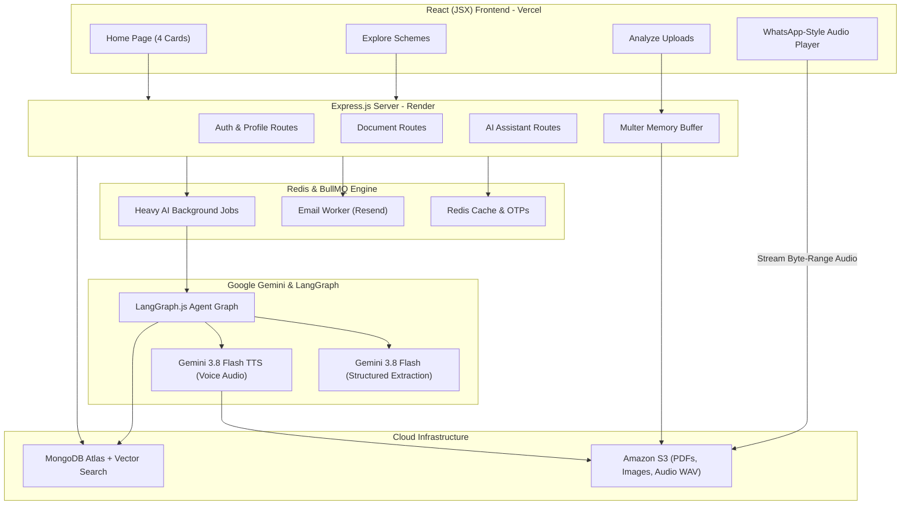

# 🏛️ Lok Setu (NagrikMitra AI) — Complete JavaScript Execution Plan
### Forge GenAI Buildathon · Theme 1: Civic Pulse, Digital Governance & Public Information
### Spectrum 1: Multilingual Policy, Rights & Scheme Explainer
**2-Person Team · 48-Hour Build · 100% JavaScript (MERN Stack)**

---

## 📋 Table of Contents
1. [Executive Summary & System Vision](#1-executive-summary--system-vision)
2. [Strict Non-Negotiable Hackathon Rules](#2-strict-non-negotiable-hackathon-rules)
3. [Design System & 8 Supported Languages](#3-design-system--8-supported-languages)
4. [Current Codebase Audit (What is Already Built)](#4-current-codebase-audit-what-is-already-built)
5. [The 4 Core Home Page Cards & Workflows](#5-the-4-core-home-page-cards--workflows)
6. [System Architecture & Data Flow (MERN + S3 + Redis + Gemini)](#6-system-architecture--data-flow)
7. [Database Schemas & Data Models Reference](#7-database-schemas--data-models-reference)
8. [Person 1 Commit Plan (Backend, RAG, AI Agents & Infra)](#8-person-1-commit-plan-backend--ai)
9. [Person 2 Commit Plan (Frontend, Data Connectors & Voice)](#9-person-2-commit-plan-frontend--ui)
10. [Joint Commits (Integration, E2E Testing, Release)](#10-joint-commits-integration--release)
11. [48-Hour Hourly Schedule](#11-48-hour-hourly-schedule)
12. [Final Definition of Done & Release Checklist](#12-final-definition-of-done)

---

## 1. Executive Summary & System Vision

### Problem
Government notifications, welfare policy drafts, and municipal by-laws are inaccessible to ordinary citizens and small businesses. They are written in dense bureaucratic legalese, buried in multi-page scanned gazettes, and lack actionable clarity regarding who qualifies, what rights exist, what penalties apply, and what immediate steps must be taken.

### Solution
**Lok Setu (NagrikMitra AI)** is an intelligent, source-grounded civic platform that ingests official government documents (and user-uploaded notices/challans), retrieves clause-level legal evidence, and converts them into **plain, regional-language voice explainers (60–90s audio pods)** alongside structured breakdowns:
* **Exact Rights & Protections:** What authorities cannot do, procedural entitlements.
* **Eligibility Checklist:** Income thresholds, caste/category, age limits, required documents.
* **Real-World Impacts:** Citizen perspective vs. Small Business / MSME perspective (fines, compliance, subsidies).
* **Actionable Roadmap:** Where to apply, required documents, deadline countdowns.

---

## 2. Strict Non-Negotiable Hackathon Rules

> [!CAUTION]
> Violating any of these rules will result in disqualification or heavy score deductions during hackathon judging.

1. **Zero Dummy/Seed Data in Runtime Code:** Never create hardcoded fake schemes, mock circulars, or placeholder government cards. All data must originate from **real official government connectors** or **real citizen document uploads**.
2. **Honest Empty States:** If the database has no policies published in the last 7 days, render an honest empty state: *"No new government policies or notifications published this week."*
3. **Mandatory Citation Grounding:** Every single AI claim must cite the exact Section/Clause/Page of the source document or output: *"This document does not clearly specify this information."*
4. **"Stated in Source" vs "AI Interpretation":** The UI must visually distinguish direct factual quotations from AI reasoning/simplification using distinct badges.
5. **Mandatory Eligibility Disclaimer:** Always display: *"You may be eligible. This is a preliminary assessment and does not constitute an official government guarantee."*
6. **No API Keys in Frontend:** All Gemini API keys, AWS credentials, and Redis/Resend secrets remain strictly in backend environment variables.
7. **Document Ownership & Privacy:** User-uploaded notices and personal demographic profiles must enforce strict ownership guards.

---

## 3. Design System & 8 Supported Languages

### A. Contemporary Editorial Indian Palette ("Neel & Vermilion")
* **Paper (Background):** `#F2EFE6` (Warm, non-glare editorial canvas)
* **Neel (Primary Navy):** `#263C59` (Authority, typography, navigation)
* **Vermilion (Primary Accent):** `#C84C32` (Action buttons, badges, notifications)
* **Sage (Subtle Green):** `#D7D9C5` (Eligibility satisfied, active status, chips)
* **Mustard (Highlight Gold):** `#E4B65A` (Deadlines, warnings, audio indicators)
* **White (Card Surface):** `#FFFFFF` (Clean, high-contrast readable cards)

*Rule:* No generic purple/blue AI gradients, no neon glow, and no heavy glassmorphism.

### B. The 8 Supported Languages (Strict)
All multi-lingual generation, i18n UI strings, and Gemini 3.8 Flash TTS voice synthesis must support these 8 languages:
1. `en` — English
2. `hi` — हिन्दी (Hindi)
3. `gu` — ગુજરાતી (Gujarati)
4. `mr` — मराठी (Marathi)
5. `kn` — ಕನ್ನಡ (Kannada)
6. `ta` — தமிழ் (Tamil)
7. `te` — తెలుగు (Telugu)
8. `bn` — বাংলা (Bengali)

---

## 4. Current Codebase Audit (What is Already Built)

The backend (`Lok Setu/backend`) has already been built, verified, and audited with pure JavaScript ES modules (`"type": "module"`). All syntax checks pass.

### Completed Backend Infrastructure
* ✅ **Dependencies Configured:** `express@5`, `mongoose@9`, `bullmq@5`, `ioredis@5`, `@aws-sdk/client-s3`, `@aws-sdk/s3-request-presigner`, `@google/genai`, `resend`, `bcrypt`, `jsonwebtoken`, `multer`, `helmet`, `cors`, `compression`, `express-rate-limit`, `rate-limit-redis`.
* ✅ **Security & Middlewares:**
  * [`src/middlewares/error.middleware.js`](backend/src/middlewares/error.middleware.js) — Centralized error handler using `ApiError`.
  * [`src/middlewares/auth.middleware.js`](backend/src/middlewares/auth.middleware.js) — JWT authentication (`verifyJWT`) and role validation (`verifyRole`).
  * [`src/middlewares/rateLimiter.middleware.js`](backend/src/middlewares/rateLimiter.middleware.js) — Redis-backed `apiRateLimiter` (100 req/15 min) and `authRateLimiter` (10 req/10 min).
  * [`src/middlewares/multer.middleware.js`](backend/src/middlewares/multer.middleware.js) — Memory storage buffer uploader (accepts PDF, DOCX, JPG, PNG, WEBP up to 10MB).
* ✅ **Asynchronous Queue & Storage:**
  * [`src/queues/email.queue.js`](backend/src/queues/email.queue.js) — BullMQ Redis queue connection with `maxRetriesPerRequest: null`.
  * [`src/workers/email.worker.js`](backend/src/workers/email.worker.js) — Background worker handling `verification_otp`, `forgot_password_otp`, and `policy_alert` via Resend API.
  * [`src/utils/s3Uploader.js`](backend/src/utils/s3Uploader.js) — AWS SDK v3 client for `uploadAudioToS3`, `uploadDocumentPdfToS3`, `uploadUserNoticeToS3`, and `getPresignedDownloadUrl`.
* ✅ **Mongoose Schemas:**
  * [`src/models/user.model.js`](backend/src/models/user.model.js) — Email, username, password (select: false), civic roles, OTPs, tokens.
  * [`src/models/userProfile.model.js`](backend/src/models/userProfile.model.js) — State, city, location (rural/urban), age, dob, preferred languages (primary, secondary, tertiary), religion, caste, gender, marital status, income range, ration card, occupation, disability (PwD).
  * [`src/models/document.model.js`](backend/src/models/document.model.js) — Schemes, gazettes, municipal laws, eligibility criteria rules, text index, 1-week notification compound index.
  * [`src/models/explainer.model.js`](backend/src/models/explainer.model.js) — Plain summary, key rights, eligibility checklist, citizen/MSME impact, S3 audio URL, compound unique index for instant cache hits.
  * [`src/models/aiChatSession.model.js`](backend/src/models/aiChatSession.model.js) — Session modes (`check_eligibility`, `analyze_document`, `general_query`), file attachments, audio URLs, citations.
  * [`src/models/userAnalyzedDocument.model.js`](backend/src/models/userAnalyzedDocument.model.js) — Citizen upload history for personal notices and challans.

---

## 5. The 4 Core Home Page Cards & Workflows

```
┌────────────────────────────────────────────────────────────────────────────────────────┐
│                                   LOK SETU HERO                                        │
│               "Understand Government Policies & Rights in Your Own Language"           │
└────────────────────────────────────────────────────────────────────────────────────────┘
       │                          │                          │                          │
       ▼                          ▼                          ▼                          ▼
┌──────────────┐           ┌──────────────┐           ┌──────────────┐           ┌──────────────┐
│   Card 1:    │           │   Card 2:    │           │   Card 3:    │           │   Card 4:    │
│    Check     │           │   Explore    │           │   Analyze    │           │     Stay     │
│ Eligibility  │           │   Schemes    │           │  Documents   │           │   Notified   │
└──────────────┘           └──────────────┘           └──────────────┘           └──────────────┘
```

### Card 1: Check Eligibility
1. User clicks **"Check Eligibility"**.
2. Frontend inspects authentication status:
   * **Logged-In:** Extracts `UserProfile` data (State, City, Age, Caste, Religion, Income, Occupation, Ration Card, Disability).
   * **Guest:** Prompts quick 4-question modal (State, Age, Income, Occupation).
3. Redirects to `/assistant?mode=check_eligibility` with pre-prompt injected.
4. Assistant runs deterministic eligibility matching against database schemes and returns:
   * Matched Schemes list with criteria satisfied vs. requiring verification.
   * `[Listen Audio 🎙️]` and `[Read Key Rights]` buttons for each scheme.

### Card 2: Explore Schemes
1. User clicks **"Explore Schemes"**.
2. Redirects to `/explore`.
3. Calls `GET /api/v1/documents?page=1&limit=10`.
4. Filters available: Jurisdiction (Central / State / Municipal), Beneficiary Category (Farmer, MSME, Student, Women), Full-Text Search.
5. Each card features: Title, Issuing Ministry, Last Date badge, and instant Audio Explainer play button.

### Card 3: Analyze Documents (Replaces "Manage Documents")
1. User clicks **"Analyze Documents"**.
2. Redirects to `/assistant?mode=analyze_document`.
3. Assistant automatically sends welcome prompt in user's `preferredLanguages.primary` (e.g. Hindi):
   > *"Namaste! Aap apna koi bhi sarkari notice, municipal order, ya policy draft (PDF, DOCX, ya Image) yahan upload karein. Main ise aasan bhasha me samjhaunga."*
4. Citizen uploads file (scanned notice photo, municipal challan, policy draft).
5. File uploads to Amazon S3 via `uploadUserNoticeToS3`.
6. Gemini 3.8 Flash extracts text, parses legal structure, generates plain explanation in primary language, and suggests secondary language pills (`[View in English]`, `[View in Marathi]`).
7. Gemini 3.8 Flash TTS synthesizes speech audio, saves to S3, and links to `UserAnalyzedDocument` so the user can revisit it anytime from their Dashboard.

### Card 4: Stay Notified
1. User clicks **"Stay Notified"**.
2. Redirects to `/notifications`.
3. Backend runs 7-day query:
   ```javascript
   const oneWeekAgo = new Date(Date.now() - 7 * 24 * 60 * 60 * 1000);
   const policies = await Document.find({
       createdAt: { $gte: oneWeekAgo },
       isActive: true
   }).sort({ createdAt: -1 });
   ```
4. If results exist: Renders chronological timeline grouped by *Today*, *Yesterday*, *This Week*.
5. If no updates exist: Renders honest empty state: *"No new government policies published in the last 7 days."*

---

## 6. System Architecture & Data Flow



---

## 7. Database Schemas & Data Models Reference

All models reside in [`backend/src/models/`](backend/src/models/):

| Model Name | File Path | Key Responsibilities |
| :--- | :--- | :--- |
| **`User`** | [`user.model.js`](backend/src/models/user.model.js) | Auth credentials, email OTP, password reset OTP, bcrypt hashing, JWT access/refresh tokens. |
| **`UserProfile`** | [`userProfile.model.js`](backend/src/models/userProfile.model.js) | Personal demographic data: state, city, rural/urban, age, dob, caste, religion, income range, occupation, PwD status, 3 preferred languages, saved schemes. |
| **`Document`** | [`document.model.js`](backend/src/models/document.model.js) | Government schemes, gazettes, municipal laws, S3 PDF URL, structured `eligibilityRules`, full-text index, 7-day notification index. |
| **`Explainer`** | [`explainer.model.js`](backend/src/models/explainer.model.js) | AI-distilled output per language: plain summary, key rights, eligibility checklist, citizen & MSME impacts, S3 audio URL and duration. |
| **`AiChatSession`** | [`aiChatSession.model.js`](backend/src/models/aiChatSession.model.js) | Multi-turn conversational memory, session modes (`check_eligibility`, `analyze_document`), file attachments, audio URLs, citations. |
| **`UserAnalyzedDocument`** | [`userAnalyzedDocument.model.js`](backend/src/models/userAnalyzedDocument.model.js) | Citizen upload history for personal notices and challans with S3 links and generated regional explanations. |
| **`Chunk`** *(To be added in P1-03)* | `chunk.model.js` | Clause-level legal document chunks with vector embeddings for Atlas Hybrid Vector Search. |

---

## 8. Person 1 Commit Plan (Backend, RAG & AI)

Person 1 owns the entire server, database, vector retrieval, and AI agent pipeline.

### P1-01: Monorepo Workspace Configuration
* **Commit:** `chore(repo): configure npm workspaces for server, client, shared in pure javascript`
* **Deliverable:** Root `package.json` with `"workspaces": ["backend", "frontend", "shared"]`. Ensure ES modules are configured throughout.

### P1-02: Shared Constants & Zod Schemas (`/shared`)
* **Commit:** `feat(shared): 8-language enums, civic roles and zod validation schemas`
* **Deliverable:** Create `/shared/constants.js` and `/shared/schemas.js` exporting:
  * 8 supported language codes (`en, hi, gu, mr, kn, ta, te, bn`) and native names.
  * Zod schemas for user registration, profile updates, and document analysis output.

### P1-03: `Chunk` Model & Atlas Vector Search Setup
* **Commit:** `feat(db): chunk model with 768-dim embeddings and atlas vector search index script`
* **Deliverable:**
  * Create `backend/src/models/chunk.model.js` (`documentId`, `pageNumber`, `clauseNumber`, `text`, `embedding: [Number]`, `charOffset`).
  * Create `backend/src/scripts/createVectorIndex.js` to initialize the Atlas Search Vector Index (`vector_index`).

### P1-04: Authentication & User Profile Controllers
* **Commit:** `feat(auth): 2fa otp registration, login, profile completion and token refresh`
* **Deliverable:**
  * Create `backend/src/controllers/auth.controller.js` and `backend/src/routes/auth.routes.js`.
  * `POST /api/v1/auth/register` (generates 6-digit OTP, queues BullMQ email job).
  * `POST /api/v1/auth/verify-otp` (activates user, generates JWT tokens).
  * `POST /api/v1/auth/login`, `POST /api/v1/auth/logout`, `GET /api/v1/auth/me`.
  * `PUT /api/v1/auth/profile` (saves state, city, occupation, caste, languages to `UserProfile`).

### P1-05: Secure Document Ingestion & Scanned Detection
* **Commit:** `feat(ingestion): upload controller with magic bytes, sha-256 hash and scanned pdf detection`
* **Deliverable:**
  * Create `backend/src/controllers/upload.controller.js`.
  * Inspect file header magic bytes (`%PDF-`, `PK\x03\x04`).
  * Compute SHA-256 hash to prevent duplicate uploads.
  * Parse page-level text using `pdf-parse`. If text < 100 chars, flag `needs_ocr: true`.
  * Upload original file buffer to S3 using `uploadUserNoticeToS3`.

### P1-06: Clause-Aware Legal Chunker
* **Commit:** `feat(ingestion): clause-aware legal chunker with page, clause and offset tracking`
* **Deliverable:**
  * Create `backend/src/services/chunker.service.js`.
  * Regex chunking recognizing: `Section \d+`, `Article \d+`, `Rule \d+`, `Clause \(\w+\)`, `Schedule`, and Hindi/Marathi legal headers (`धारा`, `नियम`).
  * Each chunk preserves `{ pageNumber, clauseNumber, text, startOffset, endOffset }`.

### P1-07: Gemini Multilingual Embeddings
* **Commit:** `feat(rag): gemini embedding-001 integration with batching and retry logic`
* **Deliverable:**
  * Create `backend/src/services/embedding.service.js`.
  * Call Gemini API `client.models.embed_content` using model `gemini-embedding-001`.
  * Batch chunk embeddings in groups of 20 with exponential backoff.
  * Bulk insert into MongoDB `chunks` collection.

### P1-08: Hybrid RAG Retrieval (Vector + Keyword Search)
* **Commit:** `feat(rag): hybrid reciprocal rank fusion retrieval with document scoping`
* **Deliverable:**
  * Create `backend/src/services/retrieval.service.js`.
  * Execute Atlas `$vectorSearch` alongside text regex search.
  * Merge scores using Reciprocal Rank Fusion (RRF: `score = 1 / (60 + rank)`).
  * Filter strictly by `documentId` and user ownership.

### P1-09: Specialized Civic Agents (Gemini 3.8 Flash)
* **Commit:** `feat(agents): classification, rights, citizen impact, and msme impact agents`
* **Deliverable:**
  * `classification.agent.js`: Extracts title, department, jurisdiction, dates, draft/superseded status.
  * `rightsEligibility.agent.js`: Extracts exact rights and eligibility criteria with citations.
  * `citizenImpact.agent.js`: Practical daily effects for families and individuals.
  * `msmeImpact.agent.js`: Business compliance, fines, tax rebates, licenses for shopkeepers.
  * `evidenceValidator.agent.js`: Verifies every claim against retrieved chunks; drops hallucinated dates/fines.

### P1-10: LangGraph.js Agent Orchestration & Live Trace (SSE)
* **Commit:** `feat(graph): langgraph execution graph with parallel agents and sse streaming`
* **Deliverable:**
  * Create `backend/src/graph/documentAnalysisGraph.js`.
  * Workflow: `Ingest` ➡️ `Classify` ➡️ `Retrieve` ➡️ `[Rights || CitizenImpact || MSMEImpact]` ➡️ `ValidateEvidence` ➡️ `Synthesize`.
  * Expose `POST /api/v1/documents/:id/analyze` streaming Server-Sent Events (SSE) for frontend live trace.

### P1-11: Multilingual Voice Synthesis (Gemini 3.8 Flash TTS)
* **Commit:** `feat(tts): gemini 3.8 flash tts voice generator with s3 caching`
* **Deliverable:**
  * Create `backend/src/services/tts.service.js`.
  * Map 8 languages to natural Gemini TTS voices (`hi: aoede`, `en: puck`, `mr: charon`, `bn: aoede`, `ta: fenrir`, `te: fenrir`, `kn: charon`, `gu: kore`).
  * Call `gemini-3.8-flash-tts` for plain-language script.
  * Upload audio buffer to S3 using `uploadAudioToS3`, save URL in `Explainer`.

### P1-12: AI Assistant & Eligibility Endpoints
* **Commit:** `feat(api): conversational assistant endpoint and deterministic eligibility matcher`
* **Deliverable:**
  * `POST /api/v1/assistant/chat`: Conversational RAG with citations and multi-turn memory (`AiChatSession`).
  * `POST /api/v1/assistant/check-eligibility`: Compares user profile against `Document.eligibilityRules` and returns criteria satisfied/unmet.

### P1-13: Notifications & Explore Query Endpoints
* **Commit:** `feat(api): 7-day notification filter and explore schemes listing endpoints`
* **Deliverable:**
  * `GET /api/v1/documents/recent?days=7`: Powers Card 4 (Stay Notified).
  * `GET /api/v1/documents`: Powers Card 2 (Explore Schemes) with pagination, type, and jurisdiction filters.

---

## 9. Person 2 Commit Plan (Frontend, UI & Connectors)

Person 2 builds the user interface, component design system, 8-language i18n, and live official government connectors.

### P2-01: React + Vite + Tailwind Scaffold (`/client`)
* **Commit:** `chore(client): vite react js, tailwind neel and vermilion palette and router shell`
* **Deliverable:**
  * Initialize Vite React in `frontend/`.
  * Configure Tailwind with exact color tokens (`paper: #F2EFE6`, `neel: #263C59`, `vermilion: #C84C32`, `sage: #D7D9C5`, `mustard: #E4B65A`).
  * Setup React Router v6 with routes: `/`, `/explore`, `/analyze`, `/assistant`, `/notifications`, `/dashboard`, `/login`, `/register`.

### P2-02: 8-Language i18n Setup
* **Commit:** `feat(i18n): react-i18next configuration for 8 indian languages with native switcher`
* **Deliverable:**
  * Configure `react-i18next` with JSON dictionaries for `en, hi, gu, mr, kn, ta, te, bn`.
  * Build persistent language dropdown in Navbar displaying native names (हिन्दी, ગુજરાતી, मराठी, etc.).

### P2-03: Reusable Design System Components
* **Commit:** `feat(ui): buttons, cards, badges, modal, empty states, and skeleton loaders`
* **Deliverable:** Accessible UI components adhering to the Neel & Vermilion palette:
  * `Button.jsx`, `Card.jsx`, `Badge.jsx` ("Stated in Source" vs "AI Interpretation").
  * `EmptyState.jsx` (essential for the zero-dummy-data rule).
  * `CitationChip.jsx` (clickable clause badges).

### P2-04: Real Government Data Connectors (`/backend/src/connectors`)
* **Commit:** `feat(connectors): live data ingestion scripts for myscheme and pib`
* **Deliverable:**
  * Create `backend/src/connectors/mySchemeConnector.js` (ingests live central/state welfare schemes).
  * Create `backend/src/connectors/pibConnector.js` (fetches official Press Information Bureau releases).
  * Upserts real data into `Document` collection with real source URLs. **No mock data!**

### P2-05: Navbar & Home Page (The 4 Interactive Cards)
* **Commit:** `feat(home): homepage hero with 4 core action cards and daily audio teaser`
* **Deliverable:** Build Home Page with:
  * Top navigation bar with Language Selector and Auth button.
  * **Card 1 (Check Eligibility):** One-tap redirect to `/assistant?mode=check_eligibility`.
  * **Card 2 (Explore Schemes):** Direct link to `/explore`.
  * **Card 3 (Analyze Documents):** Direct link to `/assistant?mode=analyze_document` (file uploader).
  * **Card 4 (Stay Notified):** Direct link to `/notifications` (within 1 week).

### P2-06: Explore Schemes Page
* **Commit:** `feat(explore): explore catalog with search, jurisdiction filters and audio play`
* **Deliverable:**
  * Search bar + chips: All, Central, State, Municipal, Farmers, MSME, Women, Students.
  * Scheme card grid with instant "Play Voice Explainer 🎙️" button and "View Rights" link.

### P2-07: Analyze Documents UI & Live Agent Trace (SSE)
* **Commit:** `feat(analyze): drag-and-drop document upload with live sse agent execution trace`
* **Deliverable:**
  * Drag-and-drop zone for PDF, DOCX, and JPG/PNG notice photos.
  * Real-time SSE Agent Execution Trace visualizing LangGraph progress:
    1. 📄 Extracting text & validating magic bytes...
    2. 🏛️ Classifying legal authority & dates...
    3. 🔍 Retrieving clause evidence...
    4. ⚖️ Analyzing Rights & MSME Impacts...
    5. 🛡️ Validating citations & evidence...
    6. ✅ Synthesizing regional voice explainer.

### P2-08: Policy & Scheme Details Page (Source vs AI Separation)
* **Commit:** `feat(policy-details): detailed view with source citation viewer and rights checklist`
* **Deliverable:**
  * Color-coded sections: 🟢 Key Rights, 🟡 Eligibility Criteria, 🔵 Citizen & MSME Impacts.
  * Interactive citation chips: clicking opens a drawer showing the original legal paragraph.
  * Official government application portal redirect button.

### P2-09: Sticky Bottom WhatsApp-Style Audio Player
* **Commit:** `feat(voice): persistent audio player with 0.75x-1.5x speed toggle and scrubber`
* **Deliverable:**
  * Global floating audio bar (remains active while browsing between pages).
  * Controls: Play/Pause, 10s skip backward/forward, speed multiplier (0.75x, 1x, 1.25x, 1.5x), language switch.
  * Streams byte-range audio directly from S3 URL.

### P2-10: Notifications Page (1-Week Filter) & User Dashboard
* **Commit:** `feat(notifications): 7-day policy timeline and personalized citizen dashboard`
* **Deliverable:**
  * `/notifications`: Timeline of updates within 7 days. Displays honest empty state if count is 0.
  * `/dashboard`: Saved schemes, personal profile details, and recently listened audio explainers.

---

## 10. Joint Commits (Integration & Release)

Both team members collaborate on these final release milestones:

### J-01: End-to-End System Integration
* **Commit:** `feat(integration): connect frontend upload to langgraph, rag, s3 and voice playback`
* **Acceptance Test:**
  1. Citizen opens home page and clicks **Card 3 (Analyze Documents)**.
  2. Uploads a real municipal circular or gazette PDF.
  3. Watches live LangGraph agent execution trace over SSE.
  4. Reads the plain-language explanation with clickable clause citations.
  5. Clicks Play to listen to the 60-second Hindi voice explainer streaming from S3.
  6. Switches language to Gujarati without re-uploading the file.

### J-02: Production Deployment
* **Commit:** `chore(deploy): deploy backend to render and frontend to vercel with atlas live connection`
* **Deliverable:**
  * Backend deployed on Render with environment variables (`GEMINI_API_KEY`, `AWS_*`, `REDIS_URL`, `MONGODB_URI`).
  * Frontend deployed on Vercel with production API URL.
  * Live health check returns `status: "ok"`.

### J-03: Final Release Package & Rehearsal
* **Commit:** `docs(submission): final readme, architecture diagram, pitch deck and demo recording`
* **Deliverable:**
  * 2–3 minute video demonstrating real AI document analysis and voice generation.
  * 5–7 slide pitch deck highlighting civic impact, zero-hallucination source grounding, and technical depth.

---

## 11. 48-Hour Hourly Schedule

```
┌─────────────┬─────────────────────────────────────┬─────────────────────────────────────┐
│ Timeline    │ Person 1 (Backend, AI & Storage)    │ Person 2 (Frontend, Connectors, UI) │
├─────────────┼─────────────────────────────────────┼─────────────────────────────────────┤
│ Hours 0–6   │ P1-01 to P1-03: Workspaces, Shared  │ P2-01 to P2-03: Vite React, Tailwind│
│             │ schemas, Vector Chunk model         │ design tokens, 8-lang i18n, UI kits │
├─────────────┼─────────────────────────────────────┼─────────────────────────────────────┤
│ Hours 6–16  │ P1-04 to P1-07: Auth controllers,   │ P2-04 to P2-06: Live PIB/myScheme   │
│             │ upload magic bytes, Legal Chunker   │ connectors, Home (4 Cards), Explore │
├─────────────┼─────────────────────────────────────┼─────────────────────────────────────┤
│ Hours 16–28 │ P1-08 to P1-10: Hybrid RAG, Gemini  │ P2-07 to P2-08: Live Agent Trace UI,│
│             │ Civic Agents, LangGraph SSE trace   │ Policy Details & Citation drawer    │
├─────────────┼─────────────────────────────────────┼─────────────────────────────────────┤
│ Hours 28–38 │ P1-11 to P1-13: Gemini TTS audio to │ P2-09 to P2-10: S3 Audio Player,    │
│             │ S3, 1-Week Notifications API, Chat  │ Notifications (7 days), Dashboard   │
├─────────────┼─────────────────────────────────────┼─────────────────────────────────────┤
│ Hours 38–44 │ Deploy Backend on Render, configure │ Deploy Frontend on Vercel, verify   │
│             │ Atlas Vector Search production index│ CORS, test end-to-end user journeys │
├─────────────┼─────────────────────────────────────┼─────────────────────────────────────┤
│ Hours 44–48 │ Joint J-01 to J-03: End-to-end testing with real government PDFs, demo video │
│             │ recording (2-3 min), slide deck finalization, and submission delivery.   │
└─────────────┴─────────────────────────────────────┴─────────────────────────────────────┘
```

---

## 12. Final Definition of Done & Checklist

Before final submission, verify every check item:

- [ ] **Zero Dummy Data:** No static/mock schemes in code; database records originate from real connectors or uploads.
- [ ] **Honest Empty States:** Notifications and Explore show clean empty states when no records match.
- [ ] **Upload & Extraction:** Real PDF, DOCX, and Image uploads successfully upload to S3 and extract text.
- [ ] **Scanned Detection:** Low-text scanned PDFs receive `needs_ocr: true` rather than crashing.
- [ ] **Source Grounding:** Every rights/eligibility claim includes a source clause citation.
- [ ] **Separation of Concerns:** "Stated in Source" is visibly separated from "AI Interpretation".
- [ ] **Voice Synthesis:** Gemini 3.8 Flash TTS generates regional audio stored on S3 and plays smoothly via the sticky player.
- [ ] **8 Languages:** English, Hindi, Gujarati, Marathi, Kannada, Tamil, Telugu, and Bengali render accurately.
- [ ] **Live Deployments:** Live URLs for both Vercel frontend and Render backend are functional and public.
- [ ] **Submission Video & Deck:** 2–3 min demo video and 5–7 slide pitch deck uploaded and linked in README.

---
*Lok Setu (NagrikMitra AI) · Forge GenAI Buildathon 2026*

