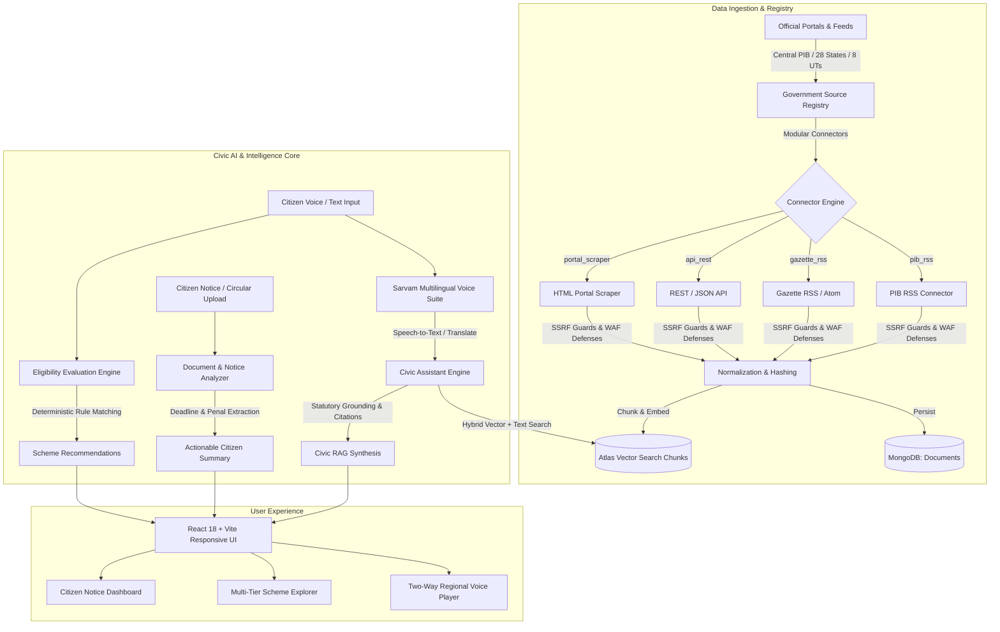

# Lok-Setu (लोक-सेतु) / NagrikMitra AI

> **Citizen-First Civic Intelligence & Multilingual Welfare Policy Platform for India**

Lok-Setu is a digital public infrastructure (DPI) platform designed to bridge the information gap between Indian citizens and complex, multi-tiered government welfare schemes, gazette notifications, and statutory circulars. By combining autonomous multi-tier government data ingestion, hybrid Reciprocal Rank Fusion (RRF) vector retrieval, deterministic eligibility evaluation, and two-way regional voice interaction powered by Sarvam AI, Lok-Setu ensures that every citizen—regardless of literacy level or language—can discover, understand, and claim the benefits they are legally entitled to.

---

## Architecture Overview



---

## Key Capabilities & Features

### 1. 🏛️ Autonomous Multi-Tier Government Ingestion
* **Validated Source Registry:** Catalogs **58 official government sources** across Central ministries, all 28 Indian States, 8 Union Territories, and municipal bodies.
* **Autonomous 24/7 Polling:** Background worker (`governmentSync.worker.js`) continuously checks and ingests new notifications.
* **Modular Connectors:** Specialized connectors for RSS 2.0, Atom feeds, REST JSON APIs, and HTML gazette tables.
* **Security & SSRF Hardening:** Blocks loopback (`127.0.0.1`), private RFC-1918 subnets, link-local (`169.254.169.254`), and cloud metadata services at every network hop.
* **Idempotent Updates:** Compares SHA-256 `contentHash` values to avoid redundant chunking and embedding, while automatically updating amended schemes with version increments (`1.0` &rarr; `1.1`).

### 2. 🧠 Grounded Hybrid RAG & Vector Search
* **Dual Indexing:** Combines 768-dimensional dense vector embeddings with lexical keyword matching via Reciprocal Rank Fusion (RRF).
* **Statutory Grounding:** Strict system prompt instructions and citation chips guarantee that answers cite official government portal URLs, section headings, and clause numbers.
* **Zero Hallucination Tolerance:** Enforces deterministic fallbacks when verified evidence is absent.

### 3. 🗣️ Two-Way Regional Voice & Sarvam AI Integration
* **8 Indian Languages Supported:** Full localization for Hindi (`hi`), Bengali (`bn`), Marathi (`mr`), Telugu (`te`), Tamil (`ta`), Gujarati (`gu`), Kannada (`kn`), and Punjabi (`pa`), alongside English.
* **Real-Time Voice Assistant:** Dual-mode speech recognition (Web Speech API + Sarvam Saaras API) paired with Bulbul TTS speech synthesis.
* **Persistent Audio Player:** Floating civic audio player with accessibility-conscious playback rates (0.75x, 1x, 1.25x, 1.5x), seeking, and track continuation across page navigation.

### 4. 🎯 Deterministic Citizen Eligibility Engine
* **Rule-Based Matching:** Evaluates profile attributes—including age, gender, caste/affirmative category, occupation, annual income ceiling, ration card status, and state domicile.
* **Transparent Outcomes:** Categorizes schemes into `Eligible`, `Near Match`, and `Ineligible`, clearly detailing criteria met and missing documentation.

### 5. 📄 Citizen Notice & Circular Analyzer
* **Statutory Document Parsing:** Ingests official PDF circulars, government orders, and scanned notices.
* **Impact Extraction:** Automatically identifies citizen deadlines, compliance dates, penalty clauses, and required citizen action steps.

---

## Tech Stack

| Layer | Technologies |
| :--- | :--- |
| **Backend Runtime** | Node.js (ESM, `>=20.0.0`), Express.js 5 |
| **Database & Search** | MongoDB Atlas, Mongoose 8+, MongoDB Atlas Vector Search (768 dimensions) |
| **Cache & Queues** | Redis (local or Upstash), BullMQ (background jobs), Rate-Limit-Redis |
| **AI & NLP** | Google Gemini 2.5 Flash (`@google/genai`), Google Text-Embeddings |
| **Voice & Multilingual**| Sarvam AI (Saaras Speech-to-Text, Bulbul Text-to-Speech, Mayura Translation) |
| **Frontend Framework** | React 18, TypeScript, Vite 6, Tailwind CSS 3.4 |
| **Icons & Styling** | Lucide React, PostCSS, Autoprefixer, clsx, tailwind-merge |
| **Storage & Email** | AWS S3 SDK v3 (pre-signed uploads), Resend (transactional alerts) |

---

## Directory Structure

```text
Lok-Setu/
├── backend/
│   ├── src/
│   │   ├── config/             # Environment, DB, Vector Index, Redis configs
│   │   ├── constants.js        # Civic, demographic, and jurisdiction constants
│   │   ├── controllers/        # Express route controllers (Assistant, Schemes, Sync)
│   │   ├── db/                 # MongoDB connection lifecycle
│   │   ├── middlewares/        # JWT auth, RBAC, Redis rate limiter, error handlers
│   │   ├── models/             # Mongoose schemas (Document, DocumentChunk, User, Scheme)
│   │   ├── routes/             # API v1 routes
│   │   ├── scripts/            # CLI utilities, database seeders, full catalog population
│   │   ├── services/
│   │   │   ├── connectors/     # Base, PIB, Gazette, REST API, & Scraper connectors
│   │   │   ├── sourceRegistry.service.js  # 58-source registry & coverage inventory
│   │   │   ├── governmentSync.service.js  # Autonomous scheme ingestion & synchronization
│   │   │   ├── indexing.service.js        # RAG chunking & vector indexing
│   │   │   ├── retrieval.service.js       # Hybrid RRF search & evidence retrieval
│   │   │   ├── eligibility.service.js     # Citizen eligibility engine
│   │   │   ├── sarvam.service.js          # Speech synthesis, translation, & transcription
│   │   │   └── gemini.service.js          # Google Gemini generative model wrappers
│   │   ├── utils/              # ApiError, ApiResponse, asyncHandler, token helpers
│   │   └── workers/            # Autonomous poller & background queue workers
│   └── test/                   # 14 comprehensive Node.js test suites (220+ tests)
│
├── frontend/
│   ├── src/
│   │   ├── components/
│   │   │   ├── auth/           # Login, registration, & protected route wrappers
│   │   │   ├── layout/         # Navigation, persistent audio player, footers
│   │   │   ├── schemes/        # Scheme cards, filters, criteria badges
│   │   │   ├── ui/             # Citation chips, status badges, modals
│   │   │   └── voice/          # Microphone controls, voice waveform visualizer
│   │   ├── context/            # Auth, Language, & Audio player React contexts
│   │   ├── pages/              # Civic Assistant, Scheme Explorer, Notice Analyzer
│   │   ├── services/           # Axios/Fetch API client bindings
│   │   └── translations/       # 8 Indian languages localization dictionary
│   └── test/                   # 7 Frontend contract and state machine test suites
│
└── docs/                       # Architectural specifications & local setup guides
```

---

## Getting Started

### Prerequisites
* **Node.js**: `v20.0.0` or higher (`v22 LTS` recommended)
* **npm**: `v10+`
* **MongoDB**: Local MongoDB instance (`mongodb://127.0.0.1:27017/loksetu`) or MongoDB Atlas URI
* **Redis**: Local Redis server (`127.0.0.1:6379`) or Upstash Redis URL

---

### Backend Setup

1. **Navigate to the backend directory and install dependencies:**
   ```bash
   cd backend
   npm install
   ```

2. **Configure environment variables:**
   ```bash
   cp .env.example .env
   ```
   Populate the `.env` file with your credentials:
   ```env
   PORT=8000
   NODE_ENV=development
   MONGODB_URI=mongodb://127.0.0.1:27017/loksetu
   CORS_ORIGIN=http://localhost:5173

   ACCESS_TOKEN_SECRET=your_64_character_hex_access_token_secret
   ACCESS_TOKEN_EXPIRY=1d
   REFRESH_TOKEN_SECRET=your_64_character_hex_refresh_token_secret
   REFRESH_TOKEN_EXPIRY=10d

   GEMINI_API_KEY=your_google_gemini_api_key
   SARVAM_API_KEY=your_sarvam_api_key

   REDIS_HOST=127.0.0.1
   REDIS_PORT=6379
   ```

3. **Seed National & State Welfare Schemes:**
   ```bash
   # Seed pan-India central and state baseline schemes
   npm run seed:panindia
   ```

4. **Start the Development Server:**
   ```bash
   npm run dev
   ```
   The backend API will run at `http://localhost:8000`.

---

### Frontend Setup

1. **Navigate to the frontend directory and install dependencies:**
   ```bash
   cd frontend
   npm install
   ```

2. **Start the Vite development server:**
   ```bash
   npm run dev
   ```
   The application will be accessible at `http://localhost:5173`.

---

## Running Autonomous Background Ingestion

Lok-Setu includes background workers and CLI triggers to automatically pull policy updates from central and regional bureaus:

```bash
# Run manual full government scheme sync
npm --prefix backend run sync:gov

# Start 24/7 background scheduler worker
npm --prefix backend run worker:gov
```

---

## Testing & Quality Assurance

Lok-Setu features a comprehensive, non-mocked test suite across backend and frontend:

```bash
# Run all 14 backend test suites (220+ tests)
npm --prefix backend test

# Run frontend contract and unit tests
npm --prefix frontend test

# Run frontend linter
npm --prefix frontend run lint

# Run frontend production build
npm --prefix frontend run build
```

---

## Security & Compliance

* **Strict SSRF Guardrails:** Outbound connector network requests resolve DNS entries and block private RFC-1918 addresses, loopbacks, link-local addresses, and cloud provider metadata IPs.
* **WAF Evasion & Resilient Fetching:** Connectors employ standards-compliant browser user agents and automatic retry strategies to prevent firewall false positives.
* **Role-Based Access Control (RBAC):** Admin and official ingestion endpoints are protected by signed JWT tokens and role verification.
* **Brute-Force & Rate Limiting:** Distributed Redis sliding-window limiters safeguard against abusive traffic and DDoS attacks.

---

## License

This project is licensed under the [ISC License](LICENSE).
Built with ❤️ for accessible civic intelligence across India.
